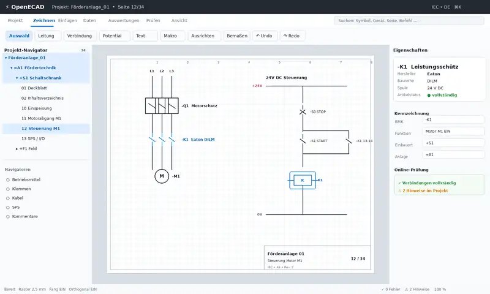
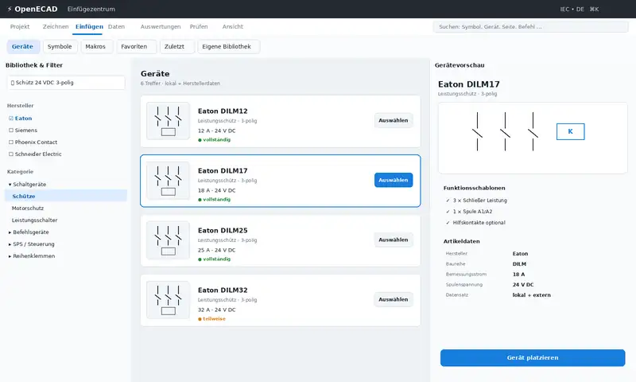
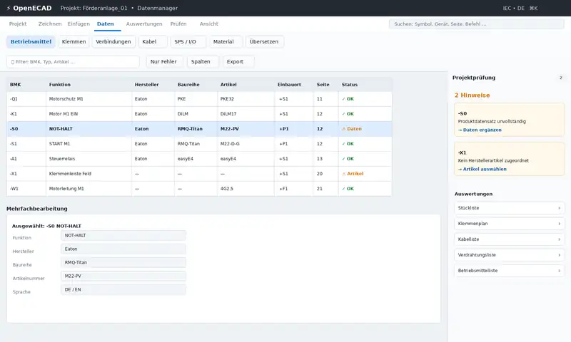
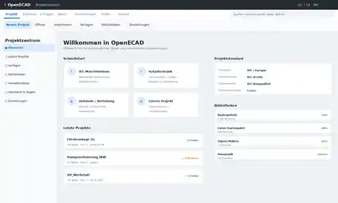

# OpenE-CAD

> **Ein modernes Open-Source-ECAD zwischen QElectroTech und EPLAN/WSCAD – leicht bedienbar wie ein moderner CAD-Editor, aber intern vollständig datenorientiert.**

OpenE-CAD ist als neue, eigenständige Open-Source-Anwendung für die Erstellung elektrotechnischer Dokumentation geplant. Die Referenzprogramme EPLAN Electric P8, WSCAD ELECTRIX, ELCAD und QElectroTech dienen ausschließlich zur Analyse etablierter Workflows, Funktionsprinzipien und Bedienkonzepte. Oberfläche, Datenmodell und Codebasis sollen neu entwickelt werden.

## Projektziele

- moderne, leicht erlernbare Desktop-Oberfläche
- **Light Mode und Dark Mode** als gleichwertige Themes
- Rust als primäre Programmiersprache
- datenorientiertes ECAD statt rein grafischem Schaltplanzeichner
- offene, dokumentierte Projekt- und Bibliotheksformate
- mehrseitige Stromlaufpläne mit automatischen Querverweisen
- Geräte, Funktionen, Anschlüsse und Artikel als echte Datenobjekte
- leistungsfähige Navigatoren und tabellarische Datenbearbeitung
- konfigurierbare Potential-/Leiterfarben, z. B. N standardmäßig blau
- Herstellerkataloge und neutrale Importformate; Eaton ist als erster Referenzhersteller vorgesehen
- automatisch generierbare und manuell korrigierbare Verteilerfrontansichten mit Reihen-/TE-Logik
- automatische Auswertungen wie Stücklisten, Klemmen-, Kabel- und Verdrahtungslisten
- vollständige technische Projekt-PDF mit Inhaltsverzeichnis, Stromlaufplänen, Aufbauplan und Auswertungen
- langfristig erweitertes Schaltschrank-Engineering, SPS/I/O, Fertigungsdaten und weitere Automatisierung

## Aktueller Stand

**Phase: Produktdefinition / UX-Konzept – noch kein Backend-Code.**

Der aktuelle Stand umfasst:

- Produktvision und Positionierung
- Vergleich und Recherche der Referenzanwendungen
- erstes Oberflächenkonzept
- fünf UI-Mockups
- Grundidee für Geräte-, Funktions- und Symbolmodell
- erste Roadmap für MVP und spätere Ausbauphasen
- Dark Mode als feste Designanforderung
- Anforderungen an Verteilerfrontansicht / Aufbauplan
- Anforderungen an farbige Potentialdarstellung
- Zielbild für vollständige technische PDF-Projektdokumentation
- v0 Design-Brief für einen unabhängigen UX-Gegenentwurf

## Dokumentation

- [Projektplan](docs/PROJECT_PLAN.md)
- [UI/UX- und Designkonzept](docs/DESIGN_CONCEPT.md)
- [Funktionsumfang und Roadmap](docs/ROADMAP.md)
- [Recherche und Referenzen](docs/RESEARCH_REFERENCES.md)
- [Anforderungen aus privaten Referenzdokumenten – abstrahiert](docs/REFERENCE_DERIVED_REQUIREMENTS.md)
- [v0 Design-Brief](docs/V0_DESIGN_BRIEF.md)
- [Fortschritt](docs/PROGRESS.md)

> Private Beispielpläne, die zur Analyse von Workflows und Ausgabeformaten verwendet werden, werden nicht im öffentlichen Repository gespeichert. Dokumentiert werden ausschließlich abstrahierte Produktanforderungen.

## Designvorschauen

### Haupteditor / Stromlaufplan



### Einfügezentrum / Eaton-Referenzkatalog



### Datenmanager / Projektprüfung



### Symbol- und Makroeditor


### Projektzentrum



Die derzeitigen Bilder zeigen den ersten Light-Mode-Entwurf. Der Dark Mode wird nicht als nachträgliche Farbvariante behandelt, sondern als gleichwertiges Theme mit eigenen Kontrast-, Raster- und Auswahlzuständen.

## Leitprinzip

OpenE-CAD soll grafische Darstellung und Engineering-Daten konsequent trennen:

```text
Symbol / Darstellung
        ↓
Funktion / Anschlusslogik
        ↓
Gerät / Betriebsmittel
        ↓
Artikel / Herstellerdaten
        ↓
Platzierungen / Auswertungen
```

Ein Schütz ist damit nicht nur eine Zeichnung. Es ist ein Gerät mit BMK, Artikel, Spule, Leistungs- und Hilfskontakten, Anschlüssen, Querverweisen, mechanischen Daten, einer möglichen Verteilerplatzierung und Beziehungen zu Stückliste, Verdrahtung und Aufbauplan.

## Lizenz

Noch nicht festgelegt. Die Lizenzentscheidung soll bewusst getroffen werden, bevor Quellcode oder Bibliotheksdaten veröffentlicht werden. Referenzprojekte werden nicht kopiert oder portiert; die Implementierung soll eigenständig entstehen.
